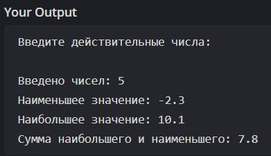

# Лабораторная работа №1: Файловые потоки ввода-вывода в C++

**Студент:** Арчаков Магомед Адамович  
**Группа:** ПИЖ-б-о-25-2  
**Вариант:** 4  
**Задание:** 6 (средний уровень)  
**Технология:** C++17

## Цель работы

Научиться работать с файловыми потоками ввода-вывода (`ifstream`, `ofstream`), читать данные из текстового файла, обрабатывать их и выводить результат.

## Задание (Задание 6, Вариант 4)

Дан файл `f`, компоненты которого являются действительными числами. Найти сумму наибольшего и наименьшего из значений компонент.

## Реализация

- Открываем файл `f.txt` через `std::ifstream`.
- Проверяем `is_open()` — если файл не открылся, выводим ошибку.
- Читаем все числа в `std::vector<double>` в цикле `while (in >> num)`.
- Находим минимум и максимум вручную.
- Выводим наименьшее, наибольшее и их сумму.
- Закрываем файл через `close()`.

## Код (`main.cpp`)

``cpp
#include <iostream>
#include <fstream>
#include <vector>

int main() {
    std::ifstream in("f.txt");
    if (!in.is_open()) {
        std::cerr << "Ошибка открытия файла f.txt" << std::endl;
        return 1;
    }

    std::vector<double> numbers;
    double num;
    while (in >> num) {
        numbers.push_back(num);
    }
    in.close();

    if (numbers.empty()) {
        std::cout << "Файл пуст." << std::endl;
        return 0;
    }

    double min_val = numbers[0];
    double max_val = numbers[0];

    for (double x : numbers) {
        if (x < min_val) min_val = x;
        if (x > max_val) max_val = x;
    }

    std::cout << "Наименьшее значение: " << min_val << std::endl;
    std::cout << "Наибольшее значение: " << max_val << std::endl;
    std::cout << "Сумма наибольшего и наименьшего: " << (min_val + max_val) << std::endl;

    return 0;
}

## Сборка и запуск

``bash
g++ -std=c++17 main.cpp -o main
./main

## Результат

## Пример файла `f.txt`

5.5 -2.3 10.1 0 7.7

## Результат

Наименьшее значение: -2.3
Наибольшее значение: 10.1
Сумма наибольшего и наименьшего: 7.8

## Выводы

В ходе работы освоено чтение вещественных чисел из текстового файла с помощью `std::ifstream`, обработка данных в контейнере `std::vector`, поиск минимального и максимального значений, а также корректное закрытие файлового потока.