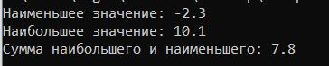

# Лабораторная работа №1: Файловые потоки ввода-вывода в C++

**Студент:** Арчаков Магомед Адамович  
**Группа:** ПИЖ-б-о-25-2  
**Вариант:** 4  
**Задание:** 6 (средний уровень)  
**Технология:** C++17

## Цель работы

Научиться работать с файловыми потоками ввода-вывода (`ifstream`, `ofstream`), читать данные из текстового файла, обрабатывать их и выводить результат.

## Задание (Задание 6, Вариант 4)

Дан файл `f`, компоненты которого являются действительными числами. Найти сумму наибольшего и наименьшего из значений компонент.

## Реализация

- Открываем файл `f.txt` через `std::ifstream`.
- Проверяем `is_open()` — если файл не открылся, выводим ошибку.
- Читаем все числа в `std::vector<double>` в цикле `while (in >> num)`.
- Находим минимум и максимум вручную.
- Выводим наименьшее, наибольшее и их сумму.
- Закрываем файл через `close()`.

## Код (`main.cpp`)

```cpp
#include <iostream>
#include <fstream>
#include <vector>

// Программа читает числа из файла f.txt, находит минимум и максимум,
// и выводит их сумму. Комментарии поясняют назначение каждого блока.

int main() {
    // Открываем файл f.txt для чтения
    std::ifstream in("f.txt");
    // Проверяем, удалось ли открыть файл (защита от отсутствия файла)
    if (!in.is_open()) {
        std::cerr << "Ошибка открытия файла f.txt" << std::endl;
        return 1; // Возвращаем код ошибки
    }

    // Вектор для хранения всех чисел из файла
    std::vector<double> numbers;
    double num;
    // Построчно (по токенам) считываем числа, пока поток не исчерпан
    // Оператор >> сам пропускает пробелы и переводы строк
    while (in >> num) {
        numbers.push_back(num);
    }
    // Закрываем файл после чтения (освобождаем ресурс)
    in.close();

    // Защита от пустого файла: если чисел нет — выводим сообщение и выходим
    if (numbers.empty()) {
        std::cout << "Файл пуст." << std::endl;
        return 0;
    }

    // Инициализируем минимум и максимум первым элементом массива
    double min_val = numbers[0];
    double max_val = numbers[0];

    // Проходим по всем числам и обновляем минимум и максимум
    for (double x : numbers) {
        if (x < min_val) min_val = x; // нашли новое минимальное
        if (x > max_val) max_val = x; // нашли новое максимальное
    }

    // Выводим результаты: минимум, максимум и их сумму
    std::cout << "Наименьшее значение: " << min_val << std::endl;
    std::cout << "Наибольшее значение: " << max_val << std::endl;
    std::cout << "Сумма наибольшего и наименьшего: " << (min_val + max_val) << std::endl;

    return 0; // Успешное завершение программы
}
```

## Сборка и запуск

```bash
g++ -std=c++17 main.cpp -o main
./main
```

## Пример файла `f.txt`

5.5 -2.3 10.1 0 7.7

## Результат



## Выводы

В ходе работы освоено чтение вещественных чисел из текстового файла с помощью `std::ifstream`, обработка данных в контейнере `std::vector`, поиск минимального и максимального значений, а также корректное закрытие файлового потока.
